# FlowHigh.AXERA

**8/16 kHz 语音 → 48 kHz 超分 · AX650 NPU3 · Python RTF 0.24（20–60 s 音频）· 2 个 axmodel 共 58 MB · 不做降噪**

  [](LICENSE) [](https://huggingface.co/HY-2012/FlowHigh.AXERA)

- HuggingFace: https://huggingface.co/HY-2012/FlowHigh.AXERA
- GitHub: https://github.com/ZY-2012/FlowHigh.AXERA
- 上游: https://github.com/jjunak-yun/FLowHigh_code

> **AX650 板端实测说明**：AudioSR、LavaSR、FlowHigh 均已在 AX650N / NPU3 板端跑通。综合效果和速度最好的是 **LavaSR**：C++ 全链路 RTF ≈ 0.061（约 16× 实时），支持 8–48 kHz → 48 kHz 和降噪。**推荐优先使用 LavaSR。**
>
> **对比入口**
> GitHub: [LavaSR](https://github.com/ZY-2012/LavaSR.AXERA) · [FlowHigh](https://github.com/ZY-2012/FlowHigh.AXERA) · [AudioSR](https://github.com/ZY-2012/AudioSR.AXERA)
> HuggingFace: [LavaSR](https://huggingface.co/HY-2012/LavaSR.AXERA) · [FlowHigh](https://huggingface.co/HY-2012/FlowHigh.AXERA) · [AudioSR](https://huggingface.co/HY-2012/AudioSR.AXERA)

## 目录

- 快速开始
- 结果
- 推理速度
- 模型转换
- 数据来源
- License

## 快速开始（AX650 板端）

从 HuggingFace 下载 `models/`、`assets/`、`python/`、`samples/`，在包根目录运行：

```bash
bash run_ax650.sh samples/listen/8k/OSR_us_000_0010_input_8k.wav output.wav
```

输入支持 8 kHz / 16 kHz，输出固定 48 kHz。默认 1-step flow、`std=1e-4`；不做降噪。

模型为 `FLowHigh_indep_adaptive_400k`（481,490,826 bytes，Flow 35.4M + BigVGAN 14.0M 参数）。AX650 侧拆成 Flow 38 MB + BigVGAN 20 MB 两个 U16/S8 axmodel；38 MB 是 S8 权重后的正常大小。

## 结果

### 8 kHz 输入（Open Speech / Samplelib）

> 长音频 OSR / samplelib 的频谱图只展示**前 5.12 秒**（FlowHigh 的第一个完整 chunk）；输入与输出使用同一时间段，方便对比。长音频后续 chunk 可能有分块高频伪影，属于运行时限制。

#### English

**OSR_us_000_0010**

| 版本 | 输入 | FlowHigh 输出 |
|---|---|---|
| 8k | [▶](https://cdn.jsdelivr.net/gh/ZY-2012/FlowHigh.AXERA@master/samples/listen/8k/OSR_us_000_0010_input_8k.wav)<br>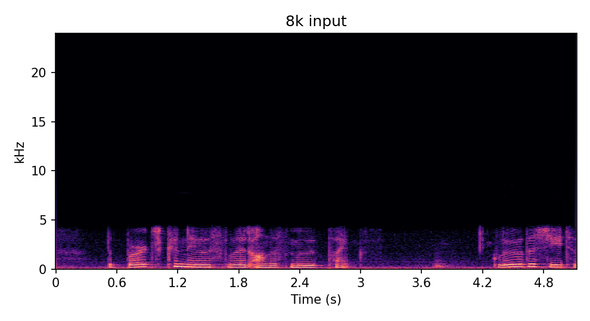 | [▶](https://cdn.jsdelivr.net/gh/ZY-2012/FlowHigh.AXERA@master/samples/listen/48k_from8k/OSR_us_000_0010_output_48k.wav)<br>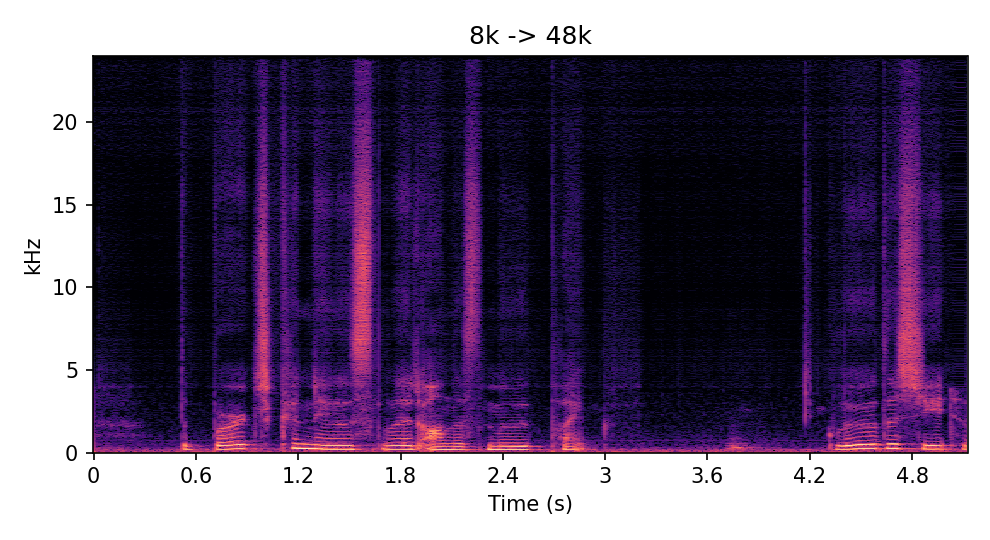 |

**OSR_us_000_0013**

| 版本 | 输入 | FlowHigh 输出 |
|---|---|---|
| 8k | [▶](https://cdn.jsdelivr.net/gh/ZY-2012/FlowHigh.AXERA@master/samples/listen/8k/OSR_us_000_0013_input_8k.wav)<br>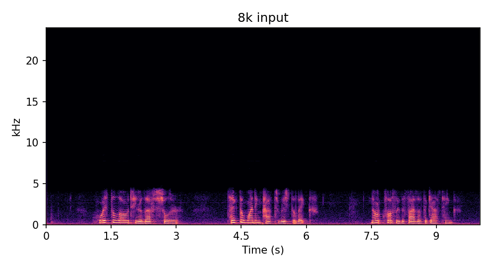 | [▶](https://cdn.jsdelivr.net/gh/ZY-2012/FlowHigh.AXERA@master/samples/listen/48k_from8k/OSR_us_000_0013_output_48k.wav)<br>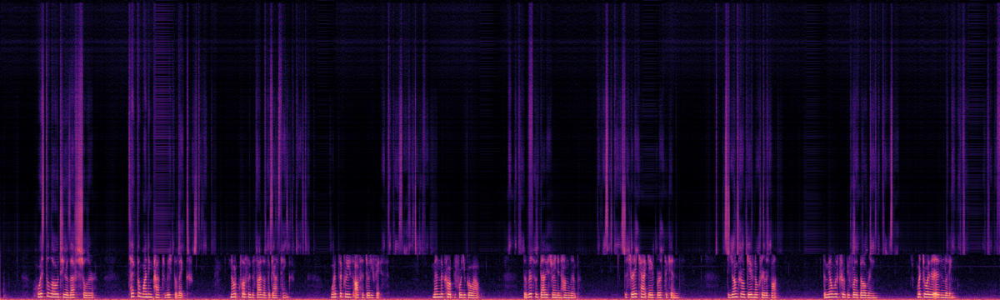 |

**OSR_us_000_0057**

| 版本 | 输入 | FlowHigh 输出 |
|---|---|---|
| 8k | [▶](https://cdn.jsdelivr.net/gh/ZY-2012/FlowHigh.AXERA@master/samples/listen/8k/OSR_us_000_0057_input_8k.wav)<br>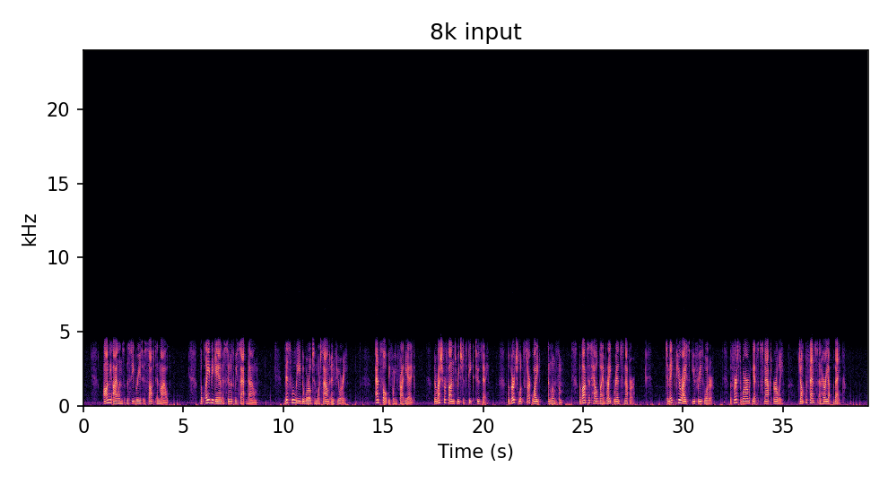 | [▶](https://cdn.jsdelivr.net/gh/ZY-2012/FlowHigh.AXERA@master/samples/listen/48k_from8k/OSR_us_000_0057_output_48k.wav)<br>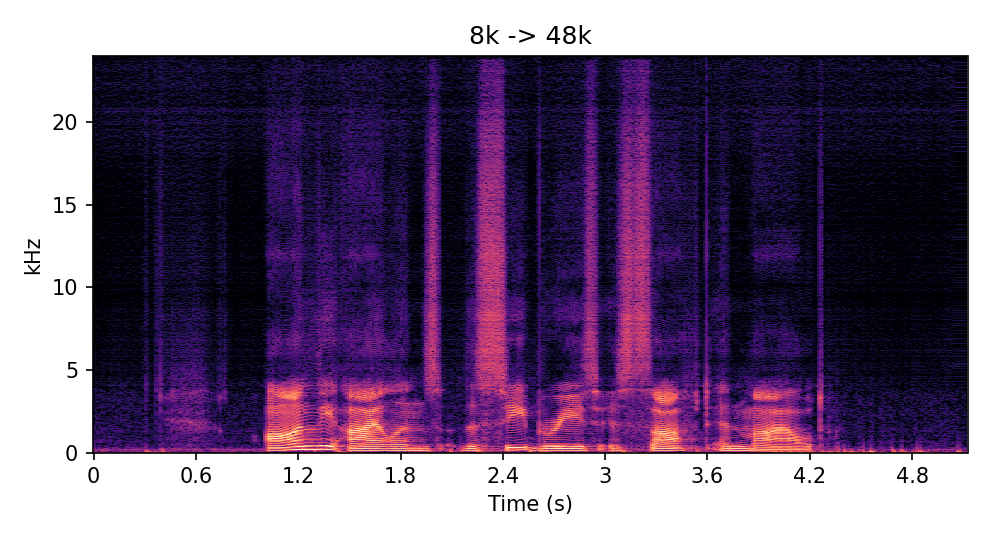 |

**OSR_us_000_0059**

| 版本 | 输入 | FlowHigh 输出 |
|---|---|---|
| 8k | [▶](https://cdn.jsdelivr.net/gh/ZY-2012/FlowHigh.AXERA@master/samples/listen/8k/OSR_us_000_0059_input_8k.wav)<br>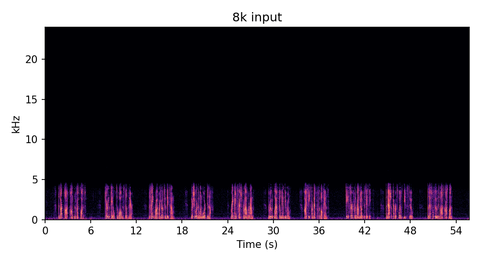 | [▶](https://cdn.jsdelivr.net/gh/ZY-2012/FlowHigh.AXERA@master/samples/listen/48k_from8k/OSR_us_000_0059_output_48k.wav)<br>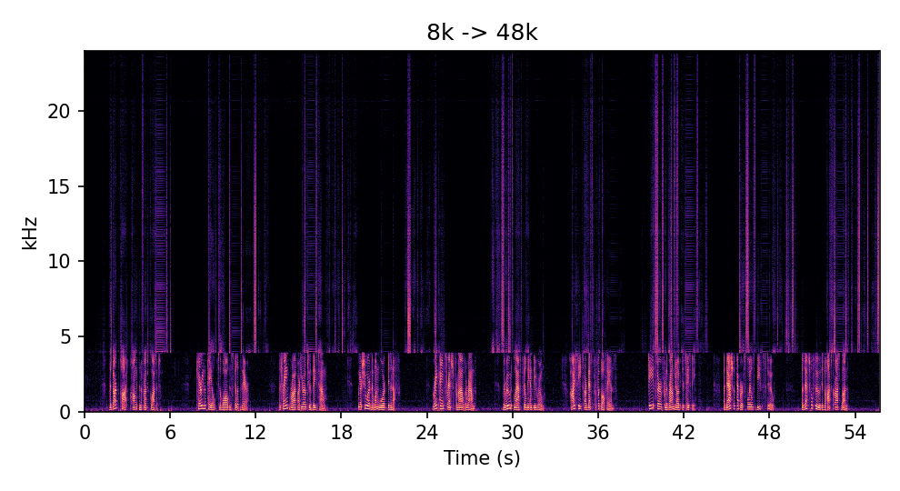 |

#### Chinese

**OSR_cn_000_0072**

| 版本 | 输入 | FlowHigh 输出 |
|---|---|---|
| 8k | [▶](https://cdn.jsdelivr.net/gh/ZY-2012/FlowHigh.AXERA@master/samples/listen/8k/OSR_cn_000_0072_input_8k.wav)<br>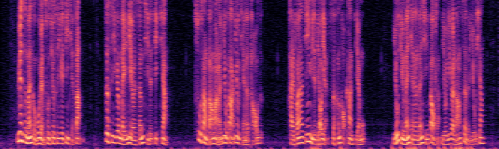 | [▶](https://cdn.jsdelivr.net/gh/ZY-2012/FlowHigh.AXERA@master/samples/listen/48k_from8k/OSR_cn_000_0072_output_48k.wav)<br>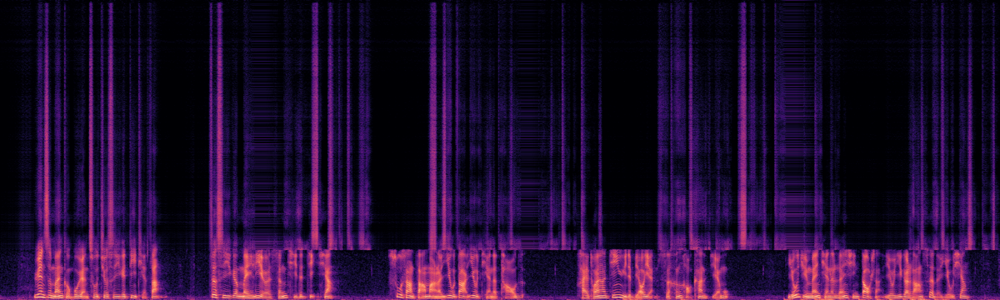 |

**OSR_cn_000_0073**

| 版本 | 输入 | FlowHigh 输出 |
|---|---|---|
| 8k | [▶](https://cdn.jsdelivr.net/gh/ZY-2012/FlowHigh.AXERA@master/samples/listen/8k/OSR_cn_000_0073_input_8k.wav)<br>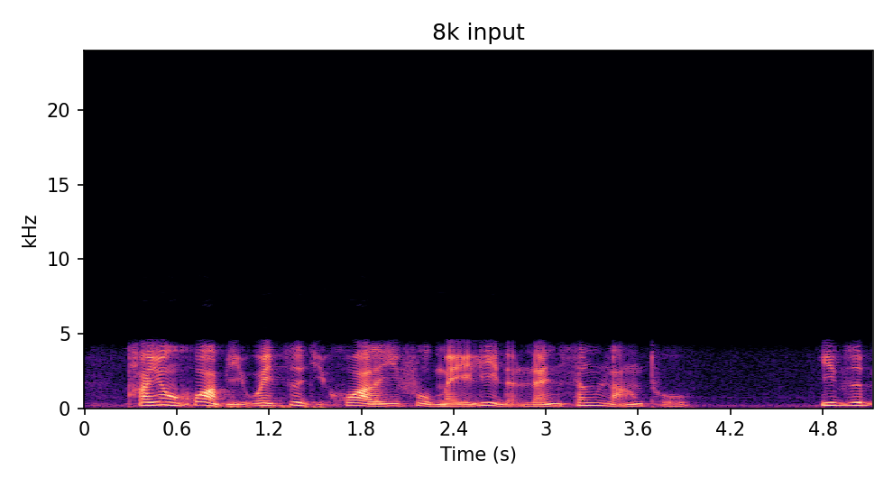 | [▶](https://cdn.jsdelivr.net/gh/ZY-2012/FlowHigh.AXERA@master/samples/listen/48k_from8k/OSR_cn_000_0073_output_48k.wav)<br>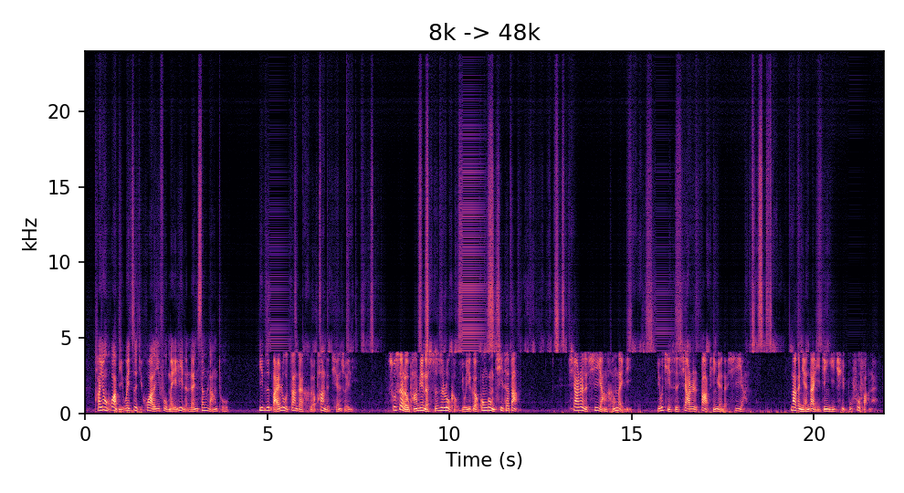 |

**OSR_cn_000_0074**

| 版本 | 输入 | FlowHigh 输出 |
|---|---|---|
| 8k | [▶](https://cdn.jsdelivr.net/gh/ZY-2012/FlowHigh.AXERA@master/samples/listen/8k/OSR_cn_000_0074_input_8k.wav)<br>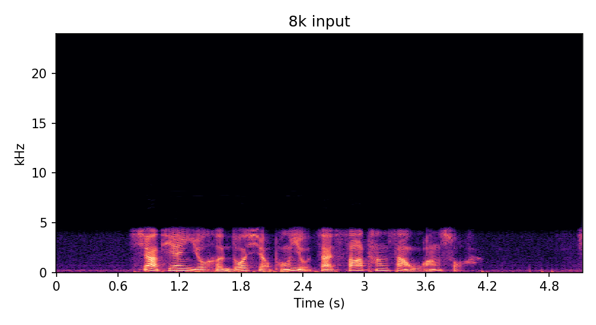 | [▶](https://cdn.jsdelivr.net/gh/ZY-2012/FlowHigh.AXERA@master/samples/listen/48k_from8k/OSR_cn_000_0074_output_48k.wav)<br>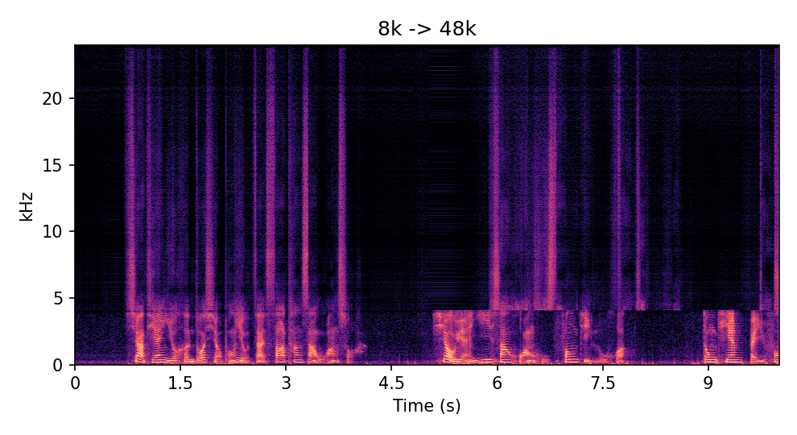 |

**OSR_cn_000_0075**

| 版本 | 输入 | FlowHigh 输出 |
|---|---|---|
| 8k | [▶](https://cdn.jsdelivr.net/gh/ZY-2012/FlowHigh.AXERA@master/samples/listen/8k/OSR_cn_000_0075_input_8k.wav)<br>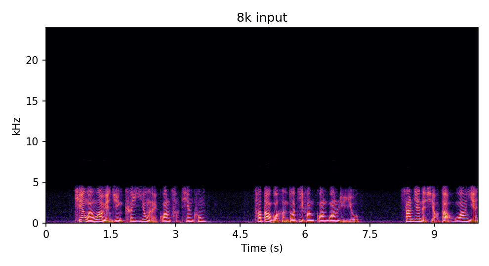 | [▶](https://cdn.jsdelivr.net/gh/ZY-2012/FlowHigh.AXERA@master/samples/listen/48k_from8k/OSR_cn_000_0075_output_48k.wav)<br>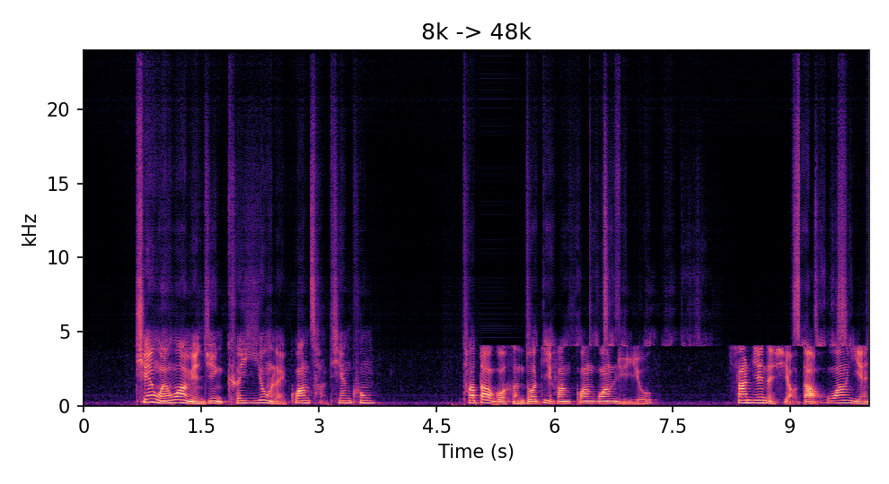 |

#### Samplelib（1 分钟，频谱图为前 10 s）

**samplelib_speech_1m**

| 版本 | 输入 | FlowHigh 输出 |
|---|---|---|
| 8k | [▶](https://cdn.jsdelivr.net/gh/ZY-2012/FlowHigh.AXERA@master/samples/listen/8k/samplelib_speech_1m_input_8k.wav)<br>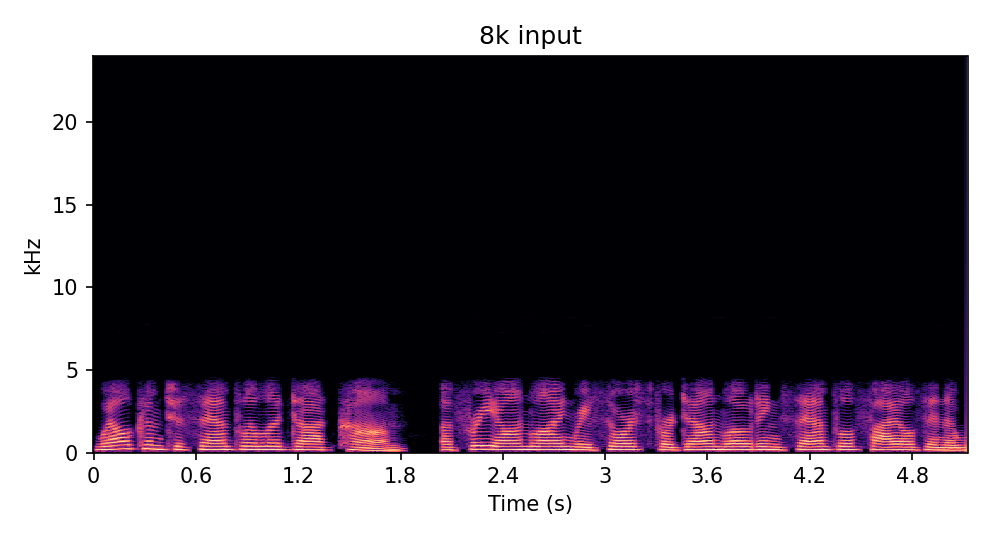 | [▶](https://cdn.jsdelivr.net/gh/ZY-2012/FlowHigh.AXERA@master/samples/listen/48k_from8k/samplelib_speech_1m_output_48k.wav)<br>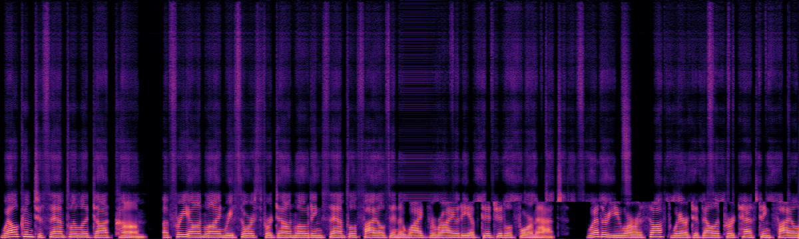 |

### 16 kHz 参照（人声）

同一批人声降采样到 16 kHz 后输入；8k 行为 8 kHz 输入，16k 行为 16 kHz 输入。

**speech_2**

| 版本 | 输入 | FlowHigh 输出 |
|---|---|---|
| 8k | [▶](https://cdn.jsdelivr.net/gh/ZY-2012/FlowHigh.AXERA@master/samples/listen/8k/speech_2_input_8k.wav)<br>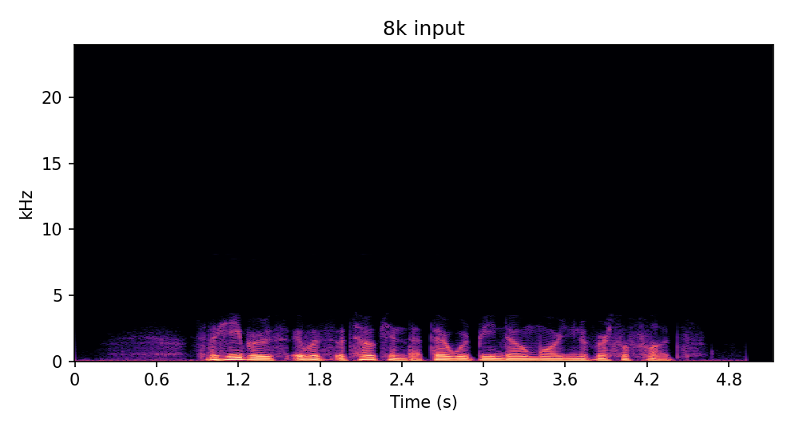 | [▶](https://cdn.jsdelivr.net/gh/ZY-2012/FlowHigh.AXERA@master/samples/listen/48k_from8k/speech_2_output_48k.wav)<br>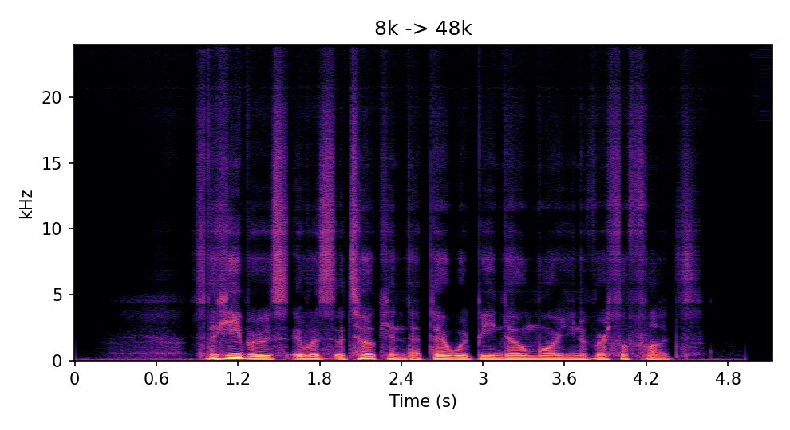 |
| 16k | [▶](https://cdn.jsdelivr.net/gh/ZY-2012/FlowHigh.AXERA@master/samples/listen/16k/speech_2_input_16k.wav)<br>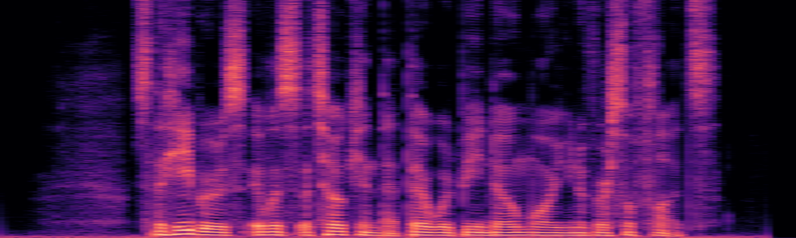 | [▶](https://cdn.jsdelivr.net/gh/ZY-2012/FlowHigh.AXERA@master/samples/listen/48k_from16k/speech_2_output_48k.wav)<br>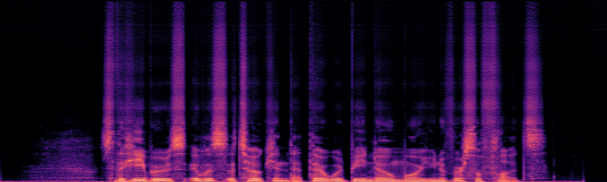 |

**speech_3**

| 版本 | 输入 | FlowHigh 输出 |
|---|---|---|
| 8k | [▶](https://cdn.jsdelivr.net/gh/ZY-2012/FlowHigh.AXERA@master/samples/listen/8k/speech_3_input_8k.wav)<br>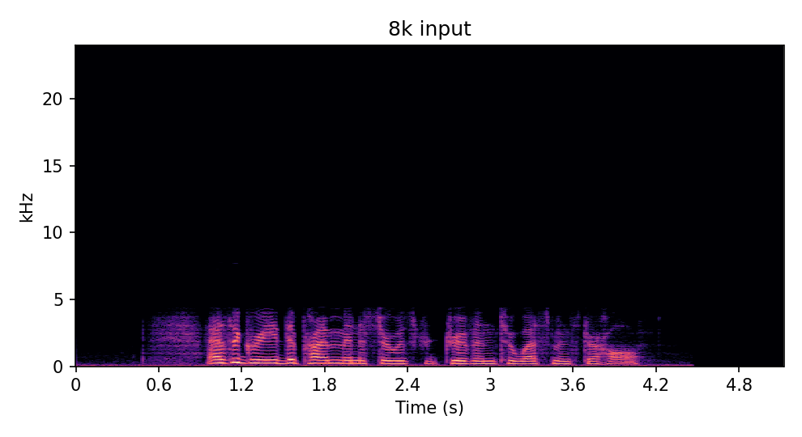 | [▶](https://cdn.jsdelivr.net/gh/ZY-2012/FlowHigh.AXERA@master/samples/listen/48k_from8k/speech_3_output_48k.wav)<br>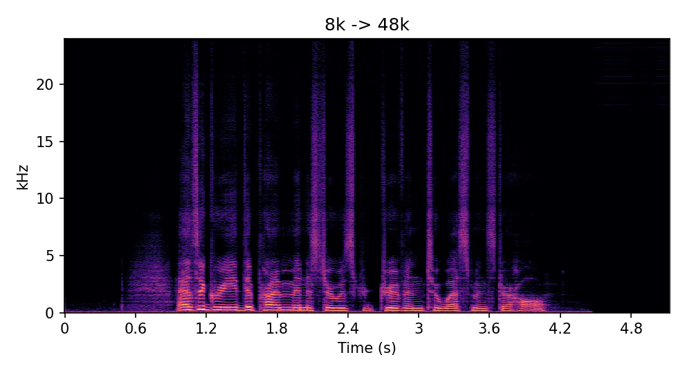 |
| 16k | [▶](https://cdn.jsdelivr.net/gh/ZY-2012/FlowHigh.AXERA@master/samples/listen/16k/speech_3_input_16k.wav)<br>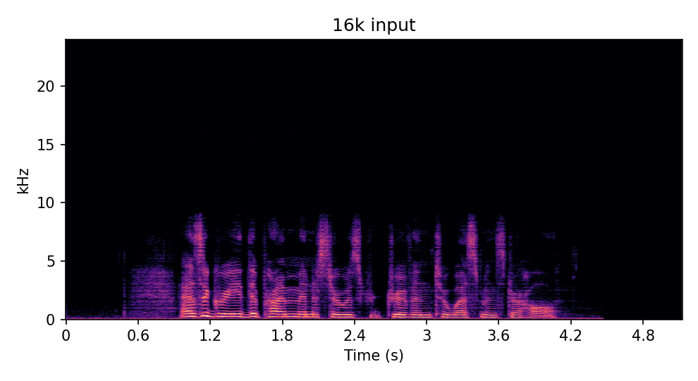 | [▶](https://cdn.jsdelivr.net/gh/ZY-2012/FlowHigh.AXERA@master/samples/listen/48k_from16k/speech_3_output_48k.wav)<br>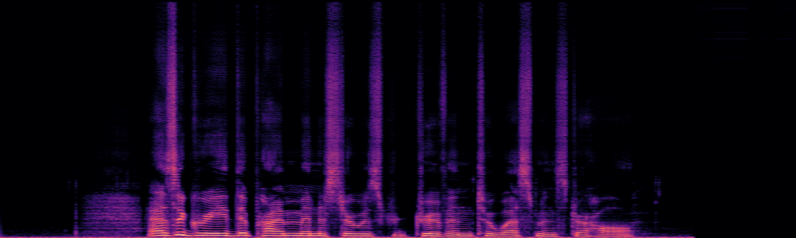 |

## 推理速度：RTF

| 链路 | Python RTF |
|---|---:|
| 8/16 kHz → 48 kHz | **0.24** |

20–60 s 音频，1-step flow，BigVGAN 1 s 分块、0.2 s overlap。5 s 短音频因分块/启动开销会略高；C++ 运行时尚未提供。

## 模型转换

```bash
python model_convert/export_flowhigh.py --frames 500 --skip-vocoder --out-dir models
python model_convert/export_flowhigh.py --frames 100 --skip-flow --out-dir models
python model_convert/make_calib.py --out-dir build/calib --clips 50
python model_convert/prepare_compile.py
PULSAR2_IMAGE=docker-registry.aitsw.axera-tech.com/pulsar2:8.0 \
  bash model_convert/compile.sh flowhigh_nct bigvgan_T100
```

Flow NPU 输入为 `[1,256,500]`（channel-first），图内转置到 `[1,500,256]`；BigVGAN 按 1 s 编译，运行时 overlap 交叉淡化。详见 `model_convert/README.md`。

## 数据来源

- Open Speech Repository（English / Chinese 8k）：http://voiptroubleshooter.com/open_speech/index.html
- Samplelib speech 1m：https://samplelib.com/mp3/sample-speech-1m.mp3
- 16 kHz 参照：公开人声样例经 48k->16k 降采样。

## License

MIT；FLowHigh 与 BigVGAN 均为 MIT。模型 checkpoint 来自上游/公开镜像，仓库不重复分发训练权重。
